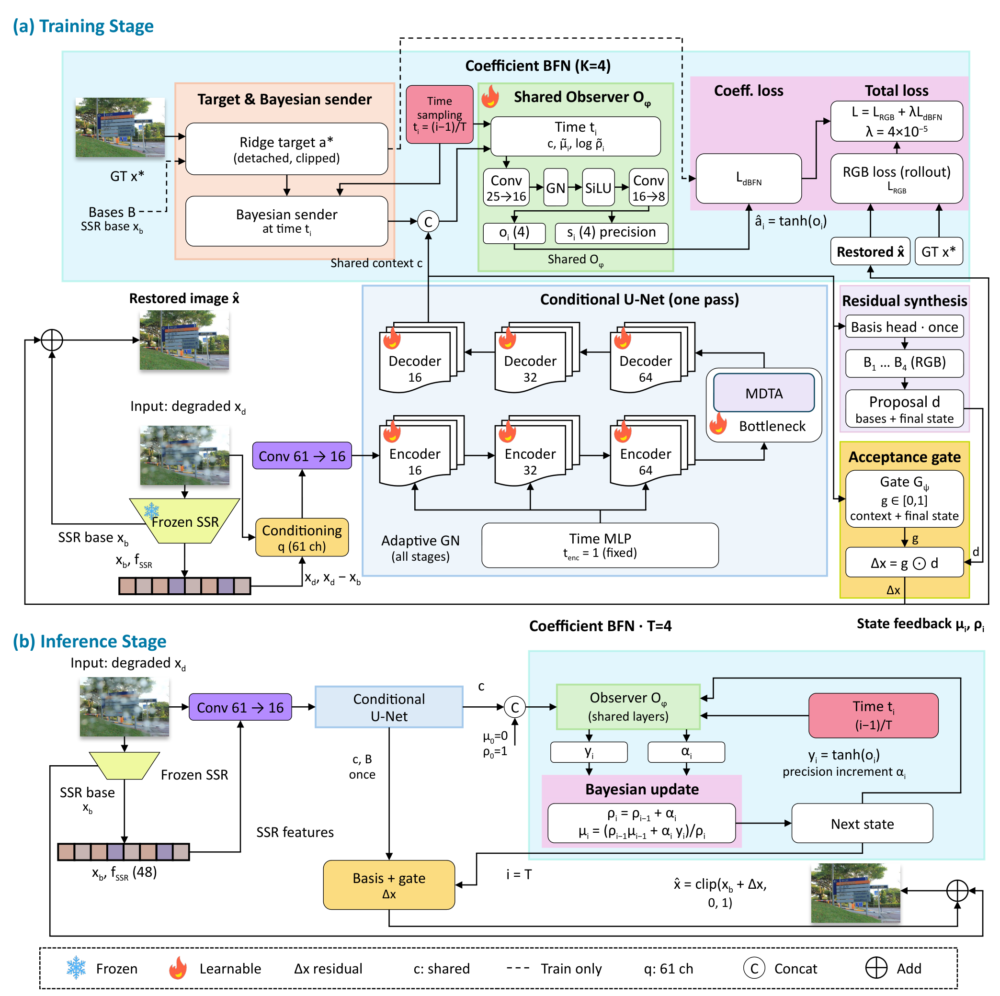

# ICML2026（4433均分3.5）｜BasisBFN

**BasisBFN：面向恶劣天气图像复原的图像依赖基底贝叶斯残差精修**

这是 **BasisBFN** 的官方 PyTorch 实现。该方法在冻结的 SSR 复原主干上
附加轻量级贝叶斯残差精修模块。

BasisBFN 一次性构造四个图像依赖的 RGB 残差基底，递推更新其空间系数的
均值和精度，并利用由后验状态条件化的接受门控，将最终校正加回 SSR 基础
复原结果。



## 方法要点

- **冻结主干。** SSR 产生基础复原图像和 48 通道 decoder feature，其参数始终
  冻结。
- **单次残差表示。** 61 通道条件 U-Net 对每张图像仅运行一次，构造共享上下文
  和四个局部 RGB 残差基底。
- **系数空间贝叶斯流。** 共享 observer 对 `4 x H x W` 系数的均值和精度执行
  四步 precision-weighted 更新。
- **后验条件接受门控。** 空间 gate 使用图像上下文、最终系数均值和 log-precision
  缩放残差 proposal。
- **identity-safe 初始化。** 零初始化 observer 与 gate 的输出投影，保证初始化时
  输出严格等于冻结 SSR 的输出。
- **轻量精修。** 完整 refinement branch 仅包含 624,217 个可训练参数。

## 论文配置

主模型为 **B4-G**：

| 配置项 | 取值 |
| --- | --- |
| 残差基底 | `K = 4` |
| 系数更新步数 | `T = 4` |
| 更新规则 | Bayesian precision-weighted fusion |
| Gate 输入 | Context + final mean + final log-precision |
| 残差尺度 | `0.2` |
| 系数目标 | Detached ridge projection，ridge `1e-3` |
| 系数 BFN loss | Equation (15)，权重 `4e-5` |
| 优化器 | AdamW，LR `2e-4`，weight decay `1e-4` |
| 训练 | 6 epochs，batch 16，BF16，EMA `0.999` |
| 论文随机种子 | `42, 43, 44, 45` |

参数匹配的消融矩阵如下：

| Arm | 系数更新 | 接受门控 |
| --- | --- | --- |
| `D4` | additive | 关闭 |
| `D4-G` | additive | 开启 |
| `B4` | Bayesian | 关闭 |
| `B4-G` | Bayesian | 开启 |

## Repository Layout

```text
sgbformer/models/coefficient_state.py  # basis, observer, flow, gate
sgbformer/models/receiver.py           # one-pass conditional U-Net
sgbformer/models/foundation.py         # external frozen SSR integration
sgbformer/models/bfn.py                # Gaussian sender and Bayesian update
sgbformer/models/model.py              # BasisBFN end-to-end model
configs/experiments/basisbfn_*.yaml    # B4-G and matched controls
scripts/preflight_basisbfn.py          # identity/gradient/protocol checks
scripts/profile_basisbfn.py            # 200-step CUDA smoke profile
scripts/analyze_basisbfn.py            # fixed endpoint matrix analysis
```

The Python package retains `sgbformer` as an import namespace for checkpoint
compatibility. The public model and loss names are `BasisBFN` and
`BasisBFNLoss`; `SGBFormer` and `SGBFormerLoss` remain aliases for older
checkpoints.

## 安装

```bash
python3 -m venv .venv
source .venv/bin/activate
pip install -r requirements.txt
pip install -e .
```

SSR 官方源码和 checkpoint 是外部运行依赖，需要单独准备。环境变量如下：

```bash
export SSR_REPO=/path/to/SSR
export SSR_CHECKPOINT="$SSR_REPO/Allweather/pretrained_models/net_g_best.pth"
export SGB_DATA_ROOT=/path/to/allweather
export ALLWEATHER_TEST_ROOT=/path/to/official/testallweather
```

## 数据来源与准备

训练数据来自 [TransWeather 官方发布的 All-Weather 合集](https://github.com/jeya-maria-jose/TransWeather#datasets)：
从 **Outdoor-Rain、Snow100K 和 RainDrop** 数据集中采样，共 **18,069 对**
退化图像与干净图像。

- [All-Weather 训练数据下载](https://drive.google.com/file/d/1tfeBnjZX1wIhIFPl6HOzzOKOyo0GdGHl/view)
- [上游文件列表下载](https://drive.google.com/file/d/1UsazX-P3sPcDGw3kxkyFWqUyNfhYN_AM/view)
- 原始数据与测试集入口：[Snow100K / DesnowNet](https://sites.google.com/view/yunfuliu/desnownet)、
  [RainDrop / DeRaindrop](https://github.com/rui1996/DeRaindrop#dataset)；
  Outdoor-Rain 的合集来源见上述 TransWeather 官方说明。

仓库提供 [`scripts/download_all_weather.sh`](scripts/download_all_weather.sh)
下载上游数据包和列表；文件整理、配对规则、固定划分与测试集目录见
**[中文数据准备说明](docs/DATASETS.md)**。

`SGB_DATA_ROOT` 应包含：

```text
input/
gt/
train_pairs.tsv
val_pairs.tsv
```

当前配置要求 **17,166 对训练数据 + 903 对验证数据**。四个模型训练种子
`42/43/44/45` 应共用同一份数据划分。

**原实验的 `train_pairs.tsv`、`val_pairs.tsv` 及其校验值目前未随仓库发布。**
仓库中的划分脚本可以重新生成确定性清单，但在缺少原清单或其校验值时，
不能保证与原实验逐图一致。数据集图像及模型权重也未上传。

正式测试集使用 **Snow100K-S、Snow100K-L、Outdoor-Rain Test1 和 RainDrop
Test-A**，应与训练／验证数据分别保存。

## Generate A Paper-Seed Config

Generate an arm/seed overlay so runs and verification artifacts cannot
overwrite one another:

```bash
python3 scripts/make_basisbfn_config.py \
  --arm B4-G \
  --seed 42 \
  --output configs/generated/basisbfn_b4g_seed42.yaml
```

Valid paper seeds are `42`, `43`, `44`, and `45`.

## Preflight And CUDA Profile

The training entry point requires a matching preflight and 200-step profile.
For B4-G seed 42:

```bash
python3 scripts/preflight_basisbfn.py \
  --config configs/generated/basisbfn_b4g_seed42.yaml \
  --output-dir runs/basisbfn/artifacts/b4-g/seed_42/preflight \
  --device cuda

python3 scripts/profile_basisbfn.py \
  --config configs/generated/basisbfn_b4g_seed42.yaml \
  --preflight runs/basisbfn/artifacts/b4-g/seed_42/preflight/preflight_b4-g.json \
  --output runs/basisbfn/artifacts/b4-g/seed_42/profile.json \
  --device cuda
```

The preflight verifies the exact parameter count, frozen SSR state, initial
identity, DCT initialization, finite coefficient BFN loss, posterior precision
growth, gate bounds, and first/second-step gradient reachability.

## Training

```bash
python3 train.py \
  --config configs/generated/basisbfn_b4g_seed42.yaml \
  --device cuda
```

The paper endpoint is the epoch-6 EMA checkpoint:

```text
runs/basisbfn/b4-g/seed_42/epoch_0006.pt
```

Repeat the same sequence for seeds `43`, `44`, and `45`. Matched D4, D4-G,
and B4 controls use the same generator with a different `--arm`.

## Inference

```bash
python3 infer.py \
  --checkpoint runs/basisbfn/b4-g/seed_42/epoch_0006.pt \
  --input /path/to/degraded/images \
  --output results/basisbfn \
  --device cuda \
  --deterministic
```

## Evaluation

Development evaluation:

```bash
python3 evaluate.py \
  --checkpoint runs/basisbfn/b4-g/seed_42/epoch_0006.pt \
  --input-dir "$SGB_DATA_ROOT/input" \
  --target-dir "$SGB_DATA_ROOT/gt" \
  --pairs-file "$SGB_DATA_ROOT/val_pairs.tsv" \
  --device cuda \
  --test-y-channel \
  --compare-structural \
  --json results/basisbfn_b4g_seed42.json
```

Paper-facing evaluation uses the untouched Snow100K-S, Snow100K-L,
Outdoor-Rain Test1, and RainDrop Test-A subsets. See
[`docs/BASISBFN.md`](docs/BASISBFN.md) and the scripts in `scripts/` for the
fixed matrix analysis.

## Reported Manuscript Results

The manuscript reports four-seed means:

| Model | Average PSNR | Average SSIM |
| --- | ---: | ---: |
| SSR | 34.15 | 0.9442 |
| BasisBFN B4-G | **34.50** | **0.9483** |

Within the matched refinement matrix, the manuscript reports `+0.10 dB` from
Bayesian fusion and `+0.08 dB` from acceptance gating. These are paper results,
not claims produced by the unit tests in this repository.

## Tests

```bash
python3 -m pytest -q
```

## Third-Party Code And Weights

See [`THIRD_PARTY_NOTICES.md`](THIRD_PARTY_NOTICES.md). SSR source and weights
are not included because the upstream repository did not provide a license
file when this integration was prepared.

## Citation

Citation metadata will be added after the anonymous review process.
